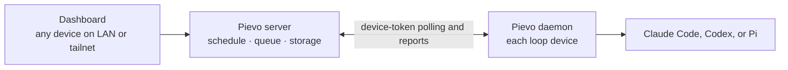

<div align="center">

# Pievo

**Run stored coding-agent prompts on a reliable schedule, across your own devices.**

Pievo schedules Claude Code, Codex, or Pi while keeping execution, credentials, and
project files on the device that runs each loop.

[](LICENSE)
[](https://github.com/kky42/pievo/stargazers)

[Source](https://github.com/kky42/pievo) · [npm](https://www.npmjs.com/package/@kky42/pievo)

</div>

## What Pievo does

A loop combines a prompt, a cron or continuous schedule, a project folder on one
device, and one of three outcomes: `keep`, `no-change`, or `block`. Each loop keeps a
memory file its runs read and update, so later runs avoid earlier mistakes, and can
maintain Markdown, HTML, or text/code artifacts the dashboard renders and diffs.

Pievo is personal software for one user. One device runs the **server** (dashboard,
scheduler, history). Every device that runs loops runs the **daemon**, which polls
the server, launches the coding agent, and reports the result. The server never
starts an LLM or executes user code.

## Quick start

**Requirements:** Node.js `>=22.13` (`>=22.19` when using Pi) and Claude Code,
Codex, or Pi installed and authenticated on each device that runs loops.

> The daemon launches coding agents unattended with the files, commands, and
> credentials available to it. Start with a disposable project or restrict access
> with `PIEVO_ROOTS`.

### 1. Start the server

On the device that should host the dashboard (it should stay on):

```bash
npm install -g @kky42/pievo@latest
pievo server start
```

```
pievo server started (pid 4242)
  local      http://127.0.0.1:3000
  lan        http://192.168.1.20:3000
  tailscale  http://macmini.tail1234.ts.net:3000   http://100.101.102.103:3000
  https      https://macmini.tail1234.ts.net
```

Open any of these URLs from a device that can reach it. `pievo server status`
prints them again.

### 2. Connect devices and create a loop

In the dashboard, click **New Loop** and follow the two steps. Run the connect
command on every device that should run loops (including the server device itself).
It installs the CLI, connects the daemon, and installs the Pievo skill. The command
contains a machine credential, so treat it and your shell history as secrets.

When setup finishes, the dashboard shows the loop and its next run. Use **Run once**
to test it immediately.

## Network access

There is no login. Anyone who can open the dashboard can run prompts on every
connected device, so the server only accepts requests from this machine, private LAN
addresses (`10/8`, `172.16/12`, `192.168/16`), and Tailscale peers. Requests from
public IP addresses are refused.

- **Home network:** devices on the same LAN use the `lan` URL.
- **Anywhere, via Tailscale:** devices in your tailnet, including a phone on cellular
  data, use the `tailscale` or `https` URL from home or away. Both the server device
  and the other device must be online in Tailscale.
- **HTTPS:** when Tailscale is running, `pievo server start` publishes
  `https://<device>.ts.net` with `tailscale serve` (tailnet-only, never Funnel). The
  first time, Tailscale may ask an admin to approve Serve and HTTPS certificates for
  the tailnet; the start output prints the approval link. Use `--no-https` to skip.
  `pievo server stop` removes the mapping.

Private LAN ranges include networks you do not own, such as café Wi-Fi. Stop the
server (or use `--host 127.0.0.1` and Tailscale HTTPS only) on untrusted networks.

If a browser cannot open `*.ts.net` URLs while the IP URLs work, a system HTTP proxy
is likely capturing those names: add `*.ts.net` to its bypass/direct rules.

## Commands

```text
pievo                         Show this machine's loops and recent runs.

Server (dashboard device)
  server start [--foreground] [--port <n>] [--host <addr>] [--no-https] [--data-dir <path>]
  server status | stop | restart

Daemon (every device that runs loops)
  daemon connect --server-url <url> [--connect-key <dk_…>]
  daemon connections
  daemon start [--foreground]
  daemon stop [--force]
  daemon restart [--force]
  daemon status

Loops
  new --json '<config>' [--dry-run]
  loops [--fields a,b] [--json]
  show [<loop>] [--full] [--json]
  log [<loop>] [--limit N] [--status keep|no-change|block] [--json]
  edit <loop> --json '<patch>' [--dry-run]
  pause <loop> | start <loop> | stop <loop>
  delete <loop> [--force]
  run stop <run>
  file list|get|set <loop> [<name>] [--from <path|->]
  skill [status|install]
```

Run `pievo --help` or `<command> --help` for the full syntax and the loop config
contract.

- `server start` is detached and idempotent; `--foreground` stays attached for a
  supervisor. `server restart` keeps the recorded host, port, and HTTPS choice.
  Defaults: port 3000, host `0.0.0.0`.
- `daemon connect` saves a per-server machine credential in owner-only
  `~/.pievo/connections.json`, selects that server, and starts the daemon. A saved
  URL can be selected again without a key; switching servers stops the current
  daemon and its runs first.
- `daemon start` waits for a fresh server heartbeat and prints `daemon online`.
- `daemon stop --force` and `daemon restart --force` may discard a terminal result
  that is not durable yet and leave local or external side effects uncertain.
- Restart never updates npm; see [Upgrade](#upgrade).

The server keeps its embedded database, loop file bytes, log, and pid record in
`~/.pievo-server`; the daemon keeps its connections, logs, report outbox, and
per-run directories in `~/.pievo`. Run exactly one server per data directory, and
stop it before backing up `~/.pievo-server`.

## How it works



The daemon has no inbound listener. It polls the server, runs each delivered prompt
once (no provider retry or session resume), and saves the terminal result to a
server-specific SQLite outbox until the server accepts it. Different loops may run
concurrently, while each loop stays serialized.

A run reports through its final response, which must end with the line
`STATUS: keep|no-change|block`. `keep` and `no-change` continue the schedule;
`block` pauses the loop. A line `ATTENTION: <reason>` just above it flags the run
for the owner (a yellow mark on the dashboard) without pausing the loop, whatever
the status. `pievo` commands are unavailable inside a run.

Each loop has server-owned files: `MEMORY.md` (at most 8000 characters) plus up to
four text/code artifacts (256 KB each) that the dashboard renders and diffs.
`MEMORY.md` holds only the loop's long-term experience (lessons runs learned the hard
way); task state, results, and history belong in an artifact. For
each run the daemon downloads them into a private `~/.pievo/runs/<run>` directory,
tells the agent the path, and uploads changed versions with the terminal report. A
version over its limit is rejected and the previous one kept; an owner edit
(`pievo file set`) made during a run wins.

## Local security controls

- `PIEVO_ROOTS=/allowed/root,/another/root` is an always-applied working-directory
  jail; roots sent by the server can only narrow it. Empty means unrestricted.
- Each agent gets an allowlisted environment: Claude Code receives only
  Claude/Anthropic credentials, Codex only Codex/OpenAI credentials, and Pi its
  documented config and built-in provider keys.
- Device and run credentials never appear in process arguments, and local
  credential files are owner-only. The initial `--connect-key` command is the
  exception: treat it and your shell history as secrets.
- Cancellation stops the agent's whole process group (TERM, then KILL). Runs time
  out after 12 hours unless `PIEVO_EXEC_TIMEOUT_MS` sets a positive override.
- `PIEVO_CLAUDE_BIN`, `PIEVO_CODEX_BIN`, and `PIEVO_PI_BIN` override agent binaries.

## Owner skill

The CLI bundles a small skill for connecting devices and creating or editing loops.
`daemon start` copies it to `~/.claude/skills/pievo` and `~/.agents/skills/pievo`
(used by Codex and Pi), replacing any skill with that name. Installation failure
never blocks the daemon, and runs do not depend on the skill. Inspect or refresh it
with `pievo skill status|install`.

## Upgrade

On every device:

```bash
npm install -g @kky42/pievo@latest
pievo daemon restart
```

On the server device, also run `pievo server restart`.

## Contributing

See [CONTRIBUTING.md](CONTRIBUTING.md).

## License

[MIT](LICENSE). Both [`@kky42/pievo`](packages/daemon/LICENSE) and
[`@kky42/pievo-server`](packages/server/LICENSE) are MIT licensed.
