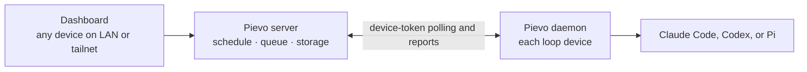

<div align="center">

# Pievo

**Run stored coding-agent prompts on a reliable schedule, across your own devices.**

Pievo schedules Claude Code, Codex, or Pi while keeping execution, credentials, and
project files on the device that runs each loop.

[](LICENSE)
[](https://github.com/kky42/pievo/stargazers)

[Source](https://github.com/kky42/pievo) · [npm](https://www.npmjs.com/package/@kky42/pievo)

</div>

## What Pievo does

A loop combines a prompt, a cron or continuous schedule, a project folder on one
device, and one of three outcomes: `keep`, `no-change`, or `block`. Each loop keeps a
memory file its runs read and update, so later runs avoid earlier mistakes, and can
maintain Markdown or HTML artifacts the dashboard renders and diffs.

Pievo is personal software for one user. One device runs the **server** (dashboard,
scheduler, history). Every device that runs loops runs the **daemon**, which polls
the server, launches the coding agent, and reports the result. The server never
starts an LLM or executes user code.

## Quick start

**Requirements:** Node.js `>=22.13` (`>=22.19` when using Pi) and Claude Code,
Codex, or Pi installed and authenticated on each device that runs loops.

> The daemon launches coding agents unattended with the files, commands, and
> credentials available to it. Start with a disposable project or restrict access
> with `PIEVO_ROOTS`.

### 1. Start the server

On the device that should host the dashboard (it should stay on):

```bash
npm install -g @kky42/pievo@latest
pievo server start
```

```
pievo server started (pid 4242)
  local      http://127.0.0.1:3000
  lan        http://192.168.1.20:3000
  tailscale  http://macmini.tail1234.ts.net:3000   http://100.101.102.103:3000
  https      https://macmini.tail1234.ts.net
```

Open any of these URLs from a device that can reach it. `pievo server status`
prints them again.

### 2. Connect devices and create a loop

In the dashboard, click **New Loop** and follow the two steps. Run the connect
command on every device that should run loops (including the server device itself).
It installs the CLI, connects the daemon, and installs the Pievo skill. The command
contains a machine credential, so treat it and your shell history as secrets.

When setup finishes, the dashboard shows the loop and its next run. Use **Run once**
to test it immediately.

## Network access

There is no login. Anyone who can open the dashboard can run prompts on every
connected device, so the server only accepts requests from this machine, private LAN
addresses (`10/8`, `172.16/12`, `192.168/16`), and Tailscale peers. Requests from
public IP addresses are refused.

- **Home network:** devices on the same LAN use the `lan` URL.
- **Anywhere, via Tailscale:** devices in your tailnet, including a phone on cellular
  data, use the `tailscale` or `https` URL from home or away. Both the server device
  and the other device must be online in Tailscale.
- **HTTPS:** when Tailscale is running, `pievo server start` publishes
  `https://<device>.ts.net` with `tailscale serve` (tailnet-only, never Funnel). The
  first time, Tailscale may ask an admin to approve Serve and HTTPS certificates for
  the tailnet; the start output prints the approval link. Use `--no-https` to skip.
  `pievo server stop` removes the mapping.

Private LAN ranges include networks you do not own, such as café Wi-Fi. Stop the
server (or use `--host 127.0.0.1` and Tailscale HTTPS only) on untrusted networks.

If a browser cannot open `*.ts.net` URLs while the IP URLs work, a system HTTP proxy
is likely capturing those names: add `*.ts.net` to its bypass/direct rules.

## Server commands

```bash
pievo server start              # detached; idempotent
pievo server start --foreground # supervisor or debugging
pievo server status             # pid and every reachable URL
pievo server restart            # keeps the recorded host, port, and HTTPS choice
pievo server stop
```

Options: `--port <n>` (default 3000), `--host <addr>` (default `0.0.0.0`),
`--no-https`, and `--data-dir <path>`. The server stores its embedded database,
loop memory and artifact bytes, log, and pid record in `~/.pievo-server`; the daemon
keeps its connection, logs, report outbox, and per-run loop-file directories in
`~/.pievo`. Run exactly one server per data
directory, and stop it before backing up `~/.pievo-server`.

## How it works



Different loops may run concurrently, while each loop remains serialized. `keep` and
`no-change` continue its schedule; `block` pauses it.

## Upgrade

On every device:

```bash
npm install -g @kky42/pievo@latest
pievo daemon restart
```

On the server device, also run `pievo server restart`.

## License

[MIT](LICENSE). Both [`@kky42/pievo`](packages/daemon/LICENSE) and
[`@kky42/pievo-server`](packages/server/LICENSE) are MIT licensed.
